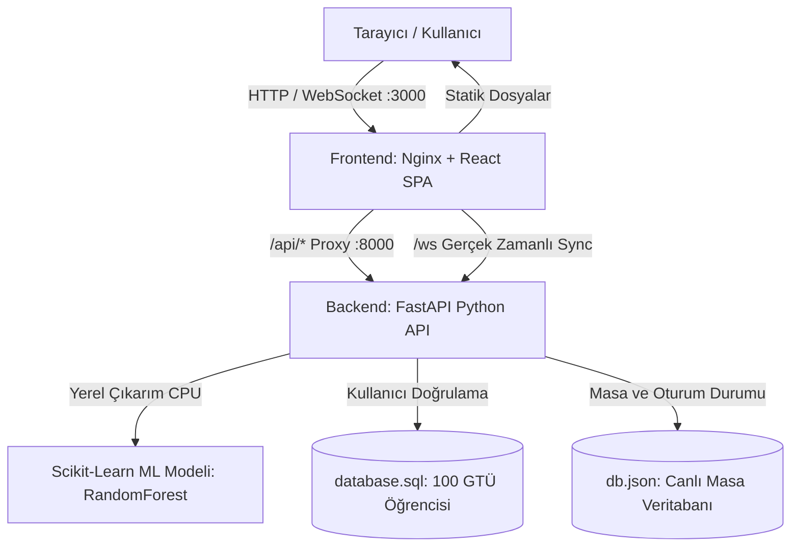

# KampusMasa: Akıllı Kütüphane Masa Yönetimi ve Doluluk Tahmin Sistemi

Gebze Teknik Üniversitesi (GTÜ) kütüphanelerindeki masa yoğunluğunu optimize eden, öğrencilere gerçek zamanlı masa rezervasyonu ve QR kod ile check-in imkanı sunan, yerel çalışan Scikit-Learn makine öğrenmesi modeliyle geleceğe dönük doluluk tahminleri üreten ve alana özgü akıllı kütüphane danışmanı barındıran üretim kalitesinde bir platformdur.

---

## Mimari ve Teknoloji Yığını

KampusMasa, ön yüz ve arka ucun tamamen ayrıştırıldığı, Docker konteynerleri üzerinde CPU ile bağımsız ve çevrimdışı çalışabilen servis mimarisine sahiptir.



### Teknoloji Bileşenleri
- **Ön Yüz (Frontend):** React 18, TypeScript, Vite, Vanilla CSS Design System, Lucide Icons, QR Scanner. Nginx üzerinde port `3000`'de yayınlanır.
- **Arka Uç (Backend):** Python 3.10, FastAPI, Uvicorn, WebSockets. Port `8000`'de hizmet verir.
- **Yapay Zekâ / Makine Öğrenmesi (AI/ML):** Scikit-Learn `RandomForestRegressor`, NumPy, Pandas, Joblib. Bulut bağımsız, 100% CPU yerel çıkarım.
- **Paketleme ve Konteynerizasyon:** Docker, Docker Compose (Multi-stage build).

---

## Kurulum ve Çalıştırma

Uygulama, GPU gerektirmeksizin standart bir bilgisayarda tek bir komutla ayağa kalkar:

```bash
docker compose up --build
```

### Servis Adresleri
- **Ön Yüz (Web Arayüzü):** `http://localhost:3000`
- **Arka Uç API:** `http://localhost:8000`
- **Etkileşimli API Dokümantasyonu (Swagger):** `http://localhost:8000/docs`
- **Sağlık Kontrolü Uç Noktası:** `http://localhost:8000/health`

### Sağlık Kontrolü (Health Check)
Servisin ve yapay zeka modelinin durumunu doğrulamak için:

```bash
curl -s http://localhost:8000/health
```

**Örnek Yanıt (HTTP 200 OK):**
```json
{
  "status": "healthy",
  "model_loaded": true,
  "ai_engine": "Scikit-Learn RandomForestRegressor (CPU)",
  "model_metrics": {
    "rmse": 4.18,
    "r2_score": 0.9737
  },
  "version": "1.0.0",
  "serverTime": 1793039250202
}
```

---

## Test Kullanıcı Giriş Bilgileri

Sistemde GTÜ veri tabanından yüklenmiş 100 aktif öğrenci hesabı bulunmaktadır (SHA-256 şifrelenmiş). Test için aşağıdaki hesapları doğrudan kullanabilirsiniz:

| Öğrenci Numarası | Şifre | Öğrenci Adı Soyadı | Rol / Durum |
| :--- | :--- | :--- | :--- |
| `359` | `359` | Ada Yılmaz | Aktif Öğrenci |
| `567` | `567` | Sude Kaplan | Aktif Öğrenci |
| `178` | `178` | Can Bozkurt | Aktif Öğrenci |
| `686` | `686` | Kerem Ergin | Aktif Öğrenci |

---

## API Uç Noktaları

| Uç Nokta | Yöntem | Açıklama |
| :--- | :--- | :--- |
| `/health` | `GET` | Sağlık kontrolü ve ML modeli bellek durumunu doğrular. |
| `/api/ai/predict` | `POST` | Saat, gün, kat ve dönem parametrelerine göre ML doluluk tahmini ve saatlik eğri üretir. |
| `/api/ai/chat` | `POST` | Kütüphane kuralları, en sessiz masalar ve doluluk tahminlerini yanıtlayan akıllı asistan. |
| `/api/login` | `POST` | Öğrenci numarası ve SHA-256 şifre ile güvenli kimlik doğrulama. |
| `/api/bootstrap` | `GET` | Canlı masa haritası, fakülte lokasyonları ve oturum verilerini tek seferde getirir. |
| `/api/reserve` | `POST` | Masayı öğrenci adına 15 dakikalık check-in süresiyle rezerve eder. |
| `/api/check-in` | `POST` | Masadaki QR kodu veya fiş kodunu doğrulayarak çalışma oturumunu başlatır. |
| `/api/release` | `POST` | Masayı boşaltır ve diğer öğrencilerin kullanımına açar. |
| `/api/break/start` | `POST` | 20 dakikalık yasal mola sayacını başlatır. |
| `/api/break/end` | `POST` | Molayı sonlandırarak aktif çalışmaya geri döner. |
| `/api/break-report` | `POST` | 20 dakikayı aşan boş bırakılmış masaları denetler ve serbest bırakır. |
| `/api/weekly-goal` | `GET/POST` | Öğrencinin haftalık çalışma saati hedefini yönetir. |
| `/ws` | `WebSocket` | Masa durum değişikliklerini tüm bağlı tarayıcılara anlık senkronize eder. |

---

## Yapay Zekâyı Nasıl Kullandık?

### 1. Üstlenilen Görev ve Problem Tanımı
Kütüphanelerde en sık karşılaşılan sorun; öğrencilerin yer bulma umuduyla kütüphaneye gelip tüm masaların dolu olduğunu görmesi veya grup çalışması için hangi katın müsait olduğunu önceden kestirememesidir. KampusMasa AI bileşeni; anlık doluluk verisini takip etmekle kalmaz, günün farklı saatleri, sınav/vize haftaları, kat dağılımı ve alan türlerine (pencere kenarı, sessiz salon, grup masaları) göre doluluk oranlarını tahmin ederek öğrencilerin çalışma saatlerini verimli planlamalarını sağlar.

### 2. Model Seçimi ve Gerekçesi
Model olarak Scikit-Learn çatısı altında **RandomForestRegressor (Topluluk Öğrenmesi - Ensemble Tree)** seçilmiştir.
- **Neden Seçildi?** Çok boyutlu doğrusal olmayan ilişkileri (saat bazlı pik saatler, vize haftası sıçramaları, alan tercih katsayıları) yüksek doğrulukla modelleyebilmektedir.
- **Düşük Kaynak Tüketimi:** Derin öğrenme modelleri ve LLM'ler gibi devasa GPU ve RAM ihtiyacı duymaz. Standart CPU üzerinde çıkarım süresi 2 milisaniyenin altındadır.
- **Bağımsızlık:** Harici API çağrılarına (OpenAI, Claude vb.) gereksinim duymadan tamamen yerel (on-premise / offline) konteyner içinde çalışır.

### 3. Eğitim ve Çıkarım Detayları
- **Eğitim Önceden Tamamlandı:** Model ağırlıkları `backend/ai/occupancy_model.joblib` dosyası olarak kaydedilmiştir. Docker imajı eğitilmiş ağırlıklarla çalışır; kullanıcının veya jürinin bilgisayarında eğitim adımı çalıştırılmaz.
- **Öznitelikler (Features):** `day_of_week` (Haftanın günü), `hour` (Günün saati 08-22), `is_weekend` (Hafta sonu göstergesi), `is_exam_period` (Sınav dönemi göstergesi), `floor` (1. veya 2. Kat), `area_type` (Pencere, Sessiz, Grup).
- **Model Metrikleri:**
  - **R² Skoru:** `0.9737` (Yüksek açıklayıcılık oranı)
  - **RMSE (Kök Ortalama Kare Hata):** `%4.18`

### 4. Kütüphane Akıllı Danışmanı (Domain-Specific Smart Assistant)
Ön yüzdeki "Akıllı Asistan" sekmesinde yer alan asistan modülü; öğrencilerin doğal dilde yönelttiği kütüphane sorularını (`/api/ai/chat`) analiz eder. Canlı masa envanteri ve Scikit-Learn tahmin motoru ile bütünleşik çalışarak öğrencilere şu konularda doğrudan yanıt üretir:
- *"Saat 15:00'te kütüphane ne kadar dolu olur?"* -> Scikit-Learn tahmin motorunu çalıştırarak hedef saat için beklenen doluluk oranını (%89.6 - Çok Yoğun) ve öneriyi iletir.
- *"Şu an en sessiz boş masa nerede var?"* -> Canlı veri tabanını tarayarak 1. Kat Sessiz Salon'daki müsait masa kodlarını listeler.
- *"Grup çalışması için kaçıncı katı önerirsin?"* -> 2. Kat grup alanındaki boş kapasiteyi hesaplar.
- *"Mola süresi kuralı nedir?"* -> 20 dakikalık mola politikasını ve otomatik boşaltma kuralını aktarır.
- Kapsam dışı veya genel sorularda kütüphane odaklı yönlendirme yaparak sistemin güvenilirliğini korur.

---

## Demo Video ve Ekran Görüntüleri

- **Demo Tanıtım Videosu:** `[Video bağlantısı buraya eklenecektir - YouTube / Loom]`
- **Sistem Ekran Görüntüleri:**
  - *Masa Haritası ve Rezervasyon:* Ön yüz üzerinden anlık boş/dolu masaların görünümü ve QR kod check-in süreci.
  - *Akıllı Asistan ve Doluluk Simülasyonu:* Saatlik tahmin çubukları, alan bazlı doluluk oranları ve soru-cevap danışmanı.
  - *Kütüphane Topluluk Panosu:* Kayıp eşya ve not paylaşım alanı.
